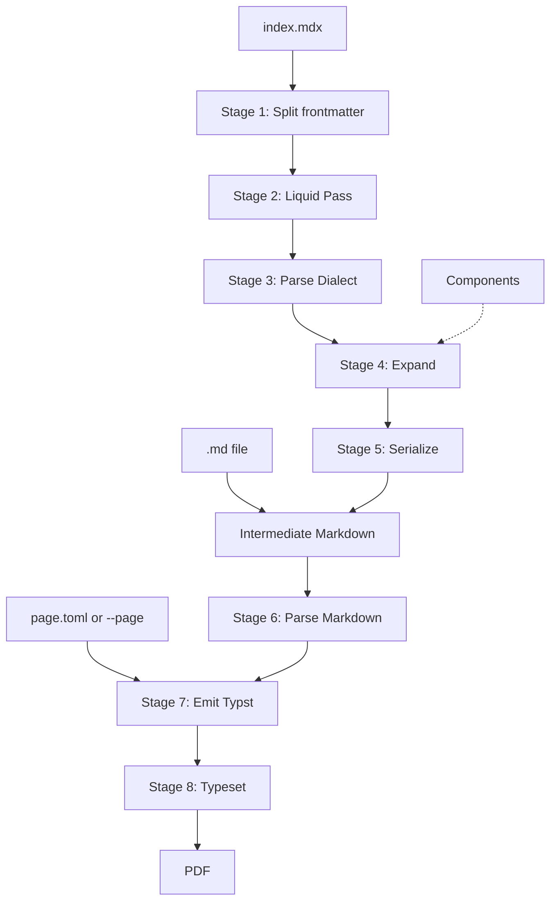

# Technical design

**Status:** Proposal, 2026-11-02. Requirements (R1–R24) are in the [PRD](prd.md), and terms are in the [glossary](../GLOSSARY.md).

**Only Spike 1 has been run.** Other claims about how crates behave come from their documentation, and the [spikes](spikes.md) exist to test them. Choices marked *(Spike N)* could change once that spike reports.

## Pipeline



| # | Stage | Input → output | Notes |
|---|---|---|---|
| 1 | Split frontmatter | File text → YAML values, body | Done on raw text, because Liquid needs the values before anything is parsed. Line endings are normalized to LF here |
| 2 | Liquid Pass | Body + scope → text | Runs on text, so it can generate tags |
| 3 | Parse Dialect | Text → tree | JSX and expressions on; ESM, HTML, and indented code off |
| 4 | Expand | Tree → tree with no MDX nodes | Runs stages 1–3 again for each Component use |
| 5 | Serialize | Tree → Markdown string | The string is the required intermediate |
| 6 | Parse Markdown | String → tree | CommonMark and GFM grammar. A Markdown Input joins at this stage |
| 7 | Emit Typst | Tree + Page Settings → Typst source | Internal only. Authors never see it |
| 8 | Typeset | Typst source → PDF bytes | In-process, through a custom `World` |

The Intermediate Markdown is the seam between two independent halves. Everything before it knows nothing about PDF, and everything after it knows nothing about MDX. Because a document can only ever contain Markdown ([ADR 0002](adr/0002-components-only-produce-markdown.md)), no document can depend on the typesetting engine, so replacing the engine would only affect stages 7 and 8.

## Evaluation

Liquid and Expressions run at different times ([ADR 0001](adr/0001-liquid-is-the-only-logic-language.md)):

| | Liquid Pass: `{{ x }}`, `` | Expression: `{ x }` |
|---|---|---|
| Runs | Before parsing, on text | After parsing, during Expansion |
| Result | Text that is then parsed as MDX | A text node, or a typed Prop value |
| Can create tags | Yes | No |
| Sees | Scope plus Liquid loop variables | Scope only |

The scope for a file is `{ ...frontmatter, meta: frontmatter, props }`. A frontmatter key named `meta` or `props` is an error.

An Expression's result becomes a text node, and the serializer escapes it. That's why `{company}` is safe with `A<B`. In text position, strings, numbers, and booleans print, and arrays or objects are an error.

Expression text goes to Liquid unchanged. The parser's fallback for expressions is brace matching rather than a JavaScript parser, so `|` isn't a problem. Evaluating to a typed value rather than a string is unproven *(Spike 3)*.

## Components

```mdx
---
props:
  type: object
  properties:
    kind: { type: string, default: Note }
---
> **{props.kind | upcase}**
>
> <Content />
```

- **Resolution:** `<Name />` looks for `./components/Name.mdx`, then `./Name.mdx`. Only names starting with an uppercase letter resolve to Components.
- **Attributes:** `kind="x"` is a string, a bare `flag` is `true`, and `count={3}` or `items={meta.items}` is an Expression evaluated in the caller's scope. Spreads are an error.
- **Props schema:** a small JSON-Schema-like subset (`type`, `properties`, `required`, `default`, `enum`), validated by our own code. A tag passing an undeclared Prop is an error.
- **Scope:** each file has its own Meta and Props, and nothing leaks into parents or siblings.
- **Liquid:** partials aren't configured, so Components are the only reuse mechanism and templates can't read files.

Expansion treats the Entry Document as a Component with no Props and no children:

```text
instantiate(file, props, children):
    scope = { ...file.frontmatter, meta: file.frontmatter, props }
    text  = liquid(file.body, scope)
    tree  = parse_dialect(text)
    for each node in tree:
        Expression     → text node of evaluate(node, scope)
        <Content />    → children (error in the Entry Document)
        <Name ...>     → instantiate(
                             resolve(Name),
                             validate(evaluate(attributes, scope)),
                             expand(node.children, scope)
                         )
        lowercase tag  → error
    return tree
```

Three properties follow from this shape:

1. **Children keep the caller's scope.** They're expanded before the Component runs, and written by the caller.
2. **No text goes through Liquid twice.** Children are tree nodes grafted in after the Component's Liquid Pass, so they aren't in its scope. `{{ x }}` in a child stays literal.
3. **Containers work automatically.** `> <Content />` holds whole blocks inside the quote, and the serializer adds the `> ` prefixes.

Recursion is detected by keeping the stack of Components being instantiated, and it reports the chain. Any Component already on the stack is an error, even if Liquid conditions would have stopped the recursion.

### Why expansion works on the tree

Splicing expanded text into the source seems simpler, but MDX and Markdown disagree about the same text. With indented code off, the line below is a paragraph in the Dialect. Re-read as Markdown, it would be a code block:

```mdx
<Callout>
    total
</Callout>
```

Working on the tree avoids this, handles container prefixes, and escapes Expression results. It also means an unclosed `**` can't cross a Component boundary, because each file parses separately. So executable.md's healing step isn't needed.

The cost is a serializer of our own, and that the intermediate doesn't preserve the author's formatting, such as `*` versus `_`. Neither affects the PDF.

### Inline and block tags

`<Note>hi</Note>` alone on a line parses as inline JSX in a paragraph. As in `@mdx-js/mdx`, a paragraph holding only tags and whitespace is unwrapped to block level ("unraveling"). A Component used mid-sentence must expand to a single paragraph, whose contents replace the tag. Anything else is an error with the location *(Spikes 2 and 5)*.

## Serialization

Stage 5 uses our own serializer, covering only the 24 node kinds Expansion can produce. `mdast_util_to_markdown` [failed Spike 1](spikes.md#spike-1-markdown-serializer): it has no support for tables, footnotes, or strikethrough, drops task list checkboxes, and silently corrupts or panics on non-ASCII text next to a literal `*` or `_`.

A serializer bug would silently change the document, so tests check this invariant on every fixture:

```text
parse_markdown(serialize(tree)) == tree, ignoring source positions
```

Besides normal escaping, it has to handle these cases, each of which broke in the spike:

- **Text that a later parse would change:** URLs and email addresses (GFM would autolink them), blank lines in a value, and `#` at the start of a heading's text.
- **Non-ASCII text:** escaping decisions must work on characters, never treat byte offsets as character indexes.
- **Nested emphasis:** `*_foo_*` must not become `**foo**`.
- **Reference labels:** must keep their original text, including emphasis.
- **Table cells:** a `|` needs escaping inside code spans too.
- **Output format:** must stay readable, because PRD success criterion 1 pins the exact Markdown for the PRD's example.

## Renderer

**Typst is the working choice, pending [Spike 4](spikes.md#spike-4-typst-embedding).** It runs in-process with no browser, its tagged PDF output is on by default since 0.14, and it brings pagination, footnotes, and bookmarks. Fulgur is the named fallback.

- **Parsing:** the same `markdown` crate as stage 3, with the GFM grammar. One parser means one tree type and fewer disagreements.
- **Emitting:** our own walk over the tree that writes Typst source. Text must be escaped so that `$5 and $6` isn't math and `Issue #42` isn't code. The mechanism (an escape table, or string literals) is *(Spike 4)*.

| Markdown | Typst |
|---|---|
| Heading, emphasis, strong | `=`, `_..._`, `*...*` |
| Bullet, numbered, and task lists | `-`, `+`, and a checkbox glyph in the item |
| Code | `raw` |
| Quote | `quote(block: true)` |
| Table, footnote, link, image | `table`, `footnote`, `link`, `image` |
| Thematic break | `line` |
| Raw HTML (Markdown Input only) | Skipped with a warning (open question in the PRD) |

- **`World`:** the source is in memory, and fonts come from the binary. There are no packages or network access, the date is fixed, and files can only be read from the asset root. `typst-kit` provides building blocks for fonts, and its `World` support was reworked in 0.15.
- **Styling:** one built-in Typst preamble gives headings, code, quotes, and tables their look. Authors can't change it except through Page Settings.
- **PDF title:** the first level-1 heading. It comes from the Markdown rather than frontmatter so that a Project and its `--emit-md` output give the same PDF (PRD success criterion 4).

## Page Settings

```toml
[paper]
size = "a4"                  # or "letter", or width and height
orientation = "portrait"

[margins]
top = "25mm"
right = "20mm"
bottom = "25mm"
left = "20mm"

[type]
font = "Libertinus Serif"    # bundled, or from the Project's fonts/ directory
size = "11pt"

[page_numbers]
enabled = true
```

Keys are engine-neutral, and values are validated by our own code, so Typst syntax can't reach the output through this file. Unknown keys are errors. All keys are optional. The final names and defaults get settled during implementation.

## Packages

### Workspace

| Crate | Job | Depends on |
|---|---|---|
| `mdx2pdf-cli` | The `mdx2pdf` binary: arguments, diagnostics, exit codes | The other two |
| `mdx2pdf-expand` | Project → Intermediate Markdown | No PDF dependencies |
| `mdx2pdf-render` | Intermediate Markdown + Page Settings → PDF bytes | Typst |

The split keeps Expansion tests from compiling Typst, and makes the seam a compile-time fact. The two library interfaces can stay very small:

```rust
// mdx2pdf-expand
pub fn expand(project: &Path) -> Result<String, ExpandError>;

// mdx2pdf-render
pub fn render(markdown: &str, page: &PageSettings, assets: &Path) -> Result<Vec<u8>, RenderError>;
```

`Cargo.lock` is committed, `rust-toolchain.toml` pins the toolchain at 1.92 or later, and the Typst crates are pinned to exact versions, because their API is still 0.x and they move in lockstep.

### External crates

Versions are current as of 2026-11-02, and each was traced to its upstream project.

| Crate | Version | Use | Risk and notes |
|---|---|---|---|
| [`markdown`](https://github.com/wooorm/markdown-rs) | 1.0.0 | Dialect and Markdown parsing | **Medium.** Stable 1.0 with full CommonMark claims, but no commits on main since 2025-04-23 and 65 open PRs. Be ready to fork |
| [`liquid`](https://github.com/cobalt-org/liquid-rust) | 0.26.11 | Liquid Pass and Expressions | **Medium.** Last release 2025-02. Still tended, with dependency updates through 2026-10 and a maintainer commit in 2026-07, but little new work. Aims for Shopify conformance |
| [`typst`, `typst-pdf`, `typst-kit`, `typst-assets`](https://github.com/typst/typst) | 0.15.1 | Typesetting and PDF | **Medium.** Actively developed, but expect breaking changes on upgrade. Needs Rust 1.92+. The upstream README only covers the CLI, so the library crates are confirmed through docs.rs and the changelog |
| [`serde-saphyr`](https://github.com/bourumir-wyngs/serde-saphyr) | 2.0.0 | Frontmatter YAML | **Low to medium.** Young (created 2025-09), but fuzz-tested, with resource budgets. Rejects duplicate keys by default. Deserializing to Liquid values is *(Spike 3)* |
| [`toml`](https://github.com/toml-rs/toml) | 1.1.8 | `page.toml` | Low. `Spanned` can give error locations |
| [`clap`](https://github.com/clap-rs/clap) | 4.6.7 | Arguments | Low |
| [`miette`](https://github.com/zkat/miette), [`thiserror`](https://github.com/dtolnay/thiserror) | 7.6.0, 2.0.21 | Errors with source spans | Low |
| [`insta`](https://insta.rs/docs/quickstart/), [`assert_cmd`](https://github.com/assert-rs/assert_cmd), `typst-render` | 1.49.0, 2.2.2, 0.15.1 | Tests only | Low |

### Alternatives rejected

| Option | Why not |
|---|---|
| `mdast_util_to_markdown` | [Failed Spike 1](spikes.md#spike-1-markdown-serializer): 93.40% of spec examples, missing GFM node kinds, and panics and silent corruption on non-ASCII text |
| `serde_yaml` | Deprecated by its author |
| `serde_yml` | [RUSTSEC-2025-0068](https://rustsec.org/packages/serde_yml.html): unsound and unmaintained |
| `mdxjs` | Compiles MDX to JavaScript, which we'd then need a runtime for |
| `chromiumoxide`, `headless_chrome` | Need a browser at runtime, which rules them out under R21 |
| `fulgur` | Kept as the fallback rather than the first choice. Created 2026-03, its README says API stability isn't guaranteed and that output can vary across machines, which conflicts with R23 |
| `genpdf` | Last released in 2021 |
| `cmarker` | Adds a second Markdown parser, and its raw-Typst comments conflict with R13 |
| `comrak`, `pulldown-cmark` | Actively maintained, but neither parses MDX, so using one would add a second parser. These are the natural alternatives if `markdown` fails stage 6 |

## Diagnostics

Errors use `miette` where a source span is available, and name the file in every case.

| Source | Where the location comes from | Quality |
|---|---|---|
| YAML, `page.toml` | Parser spans | Good |
| Liquid | The engine's error message | To be seen *(Spike 3)* |
| MDX parse, unknown Component, Props | Spans into the **Liquid output**, not the source | **Weak.** After the Liquid Pass, line numbers no longer match the file |

Mapping Liquid output back to source lines probably isn't practical, so the fallback is to show the rendered snippet along with the file name *(Spike 3)*.

Typst errors are usually our bugs, since authors can't write Typst. Missing images and fonts get checked before typesetting so that they produce useful messages, and anything left is reported as an internal error, with `--emit-md` as the way to get the input for a bug report.

Common mistakes get specific hints. See [known hazards](#known-hazards).

## Determinism and safety

- **Determinism (R23):** no system fonts, no network, a fixed date, and a fixed or absent PDF timestamp and identifier. Tests compare SHA-256 hashes *(Spike 4)*.
- **No code runs:** there's no JavaScript, and in this configuration Liquid can't read files or reach the network.
- **Files:** images and fonts must resolve inside the asset root after symlinks are resolved. Component names can't contain path separators.
- **Not a sandbox:** a `` loop can still use unbounded time and memory. Nesting depth is limited, but the tool assumes documents come from their author rather than from an untrusted source.

## Testing

| Level | How |
|---|---|
| Expansion | `insta` snapshots of fixture Projects → Intermediate Markdown |
| Serialization | The round-trip invariant on every fixture, plus the CommonMark spec examples |
| Hazards | One fixture for each row of [known hazards](#known-hazards) |
| CLI | `assert_cmd`: exit codes, messages, `--emit-md`, `--page` |
| PDF content | Text extraction with `pdftotext`, a test-only tool |
| PDF appearance | `typst-render` page images, snapshotted |
| Determinism | Two runs compared by SHA-256, plus PRD success criterion 4 |

## Relationship to executable.md

[executable.md](https://executable.md) is the inspiration for the format, not the implementation. This comparison comes from its site and the opening section of its [draft spec](https://github.com/taras/executable.md/blob/main/specs/executable-mdx-spec.md), not the whole spec.

| executable.md | mdx2pdf |
|---|---|
| Tags resolve to files, searching `./components` then `./` | Kept, with `.mdx` files rather than `.md` |
| YAML frontmatter as `meta` | Kept |
| JSON-Schema-like `props:`, validated with defaults | Kept, as a small subset |
| `<Content />` for children | Kept |
| Root document treated like a component, with scoped bindings | Kept |
| Fences and inline code are inert to tags | Kept for tags and Expressions, but the Liquid Pass still runs inside them (R6) |
| JavaScript expressions and `eval` | Replaced by Liquid syntax |
| `<If>`, `<Loop>`, `<Let>` | Replaced by Liquid's ``, ``, and `` |
| `exec`, `daemon`, journaling, agents | Left out: this tool only produces documents |
| Healing text with `remend` | Not needed: each file parses separately to a tree |
| *(no Liquid)* | Added |

## Known hazards

Small inputs likely to break a naive implementation. Each gets a test fixture, and the failures are the reason for specific hints in error messages. Behaviors marked with a spike other than Spike 1 haven't been observed yet.

| Input | Problem | Handling | Spike |
|---|---|---|---|
| `run: echo ${{ secrets.TOKEN }}` in a code fence | Liquid evaluates it or fails | By design (R6). Error hint suggests `` | 3 |
| `{{ company }}` with `company: "A<B"` | Value breaks MDX parsing | Use `{company}`. Error hint suggests it | 3, 5 |
| `<Card title="{{ t }}" />` with `t: 'Say "hi"'` | Value breaks the attribute | A custom filter to quote values as attributes | 3 |
| `<Card title={i.name} />` | `i` no longer exists when `{i.name}` runs | Clear undefined-variable error suggesting `{{ }}` | 3, 5 |
| `<A style={{color: "red"}} />` | MDX habit, and Liquid claims the `{{` | Error hint explaining the difference | 3 |
| `> a`, ``, `> b`, `` on separate lines | Blank lines split one quote into two, and `` can glue lines together | Document the pattern and test it | 3 |
| `<Note>hi</Note>` alone on a line | Parses as inline | Unravel to block level | 2, 5 |
| `Hello <Note /> there`, where `Note` has two paragraphs | Blocks in inline position | Error with location | 5 |
| `    total` inside a tag | A paragraph in MDX, code in Markdown | Tree expansion and serialization | 1, 5 |
| `\<div>` | Text in MDX, and unescaped would be an HTML block in Markdown | Serializer must escape it | 1 |
| `<https://a.b>`, `<!-- x -->`, `<br>` | Legal Markdown, but not legal in the Dialect | Listed differences, with hints such as using `[text](url)` | 2 |
| `import Chart from './Chart.mdx'` | With ESM off, silently prints as text | Must be detected and reported (R8) | 2 |
| `Use {curly} braces` | Read as an Expression | Undefined-variable error, with `\{` as the fix | 2 |
| `{x \| replace: "}", ""}` | Brace matching may not understand strings | Find out, then document | 2 |
| `$5 and $6`, `Issue #42` | Typst reads them as math and code | Escaping in stage 7 | 4 |
| A long inline code span with a line break before `[`, in LF or CRLF | Panicked `mdast_util_to_markdown`, and tests whether line breaks in code spans survive | Our serializer has its own fixture for it | 1 |
| `é\*x\*é`, `при_вет_` | Non-ASCII text beside a literal `*` or `_` corrupted or panicked the crate | Our serializer has a fixture for each | 1 |
| `https://a.b` as an Expression result | Text that GFM would turn into a link | Our serializer escapes it | 1 |
| `a\n\nb` as an Expression result | A blank line splits the paragraph | Our serializer encodes the line breaks, for example as `&#10;` | 1 |

## Delivery

1. **Prepare.** Done: `.devcontainer/install.sh` installs Rust 1.92 or later when the container starts.
2. **[Spikes](spikes.md).** Run them and record findings. Update this document, and write an ADR for the Renderer once Spike 4 settles it. Delete the spike code.
3. **Milestone 1: Markdown to PDF.** `mdx2pdf-cli` and `mdx2pdf-render`, Markdown Input, `--page`. This is already a useful tool, and it proves the second half of the pipeline.
4. **Milestone 2: Projects without Components.** Frontmatter, Liquid, Expressions, `--emit-md`, serialization.
5. **Milestone 3: Components.** Resolution, Props, `<Content />`, unraveling, recursion errors.
6. **Milestone 4: Release.** Error-message hints for every known hazard, default styling, and prebuilt binaries.
