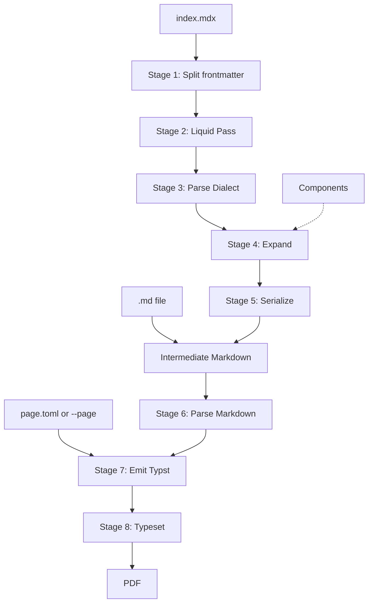

# Technical design

**Status:** Proposal, 2026-11-02. Requirements (R1–R26) are in the [PRD](prd.md), and terms are in the [glossary](../GLOSSARY.md).

**Only Spike 5 hasn't been run.** Other claims about how crates behave come from their documentation, and the [spikes](spikes.md) exist to test them. Choices marked *(Spike N)* could change once that spike reports.

## Pipeline



| # | Stage | Input → output | Notes |
|---|---|---|---|
| 1 | Split frontmatter | File text → YAML values, body | Done on raw text, because Liquid needs the values before anything is parsed. Line endings are normalized to LF here |
| 2 | Liquid Pass | Body + scope → text | Runs on text, so it can generate tags. See [running Liquid](#running-liquid) |
| 3 | Parse Dialect | Text → tree | With `markdown`, inside a [panic guard](#parsing-the-dialect). JSX and expressions on; ESM, HTML, indented code, and literal autolinks off |
| 4 | Expand | Tree → normalized tree with no MDX nodes | Runs stages 1–3 again for each Component use. See [normalization](#normalization) |
| 5 | Serialize | Tree → Markdown string | With `pulldown-cmark-to-cmark`. The string is the required intermediate. Re-parsed and [checked](#round-trip-check) on every run |
| 6 | Parse Markdown | String → events | With `pulldown-cmark` ([ADR 0003](adr/0003-two-markdown-parsers.md)). CommonMark plus GFM tables, task lists, strikethrough, and footnotes. A Markdown Input joins at this stage |
| 7 | Emit Typst | Events + Page Settings → Typst source | Internal only. Authors never see it |
| 8 | Typeset | Typst source → PDF bytes | In-process, through a custom `World` |

The Intermediate Markdown is the seam between two independent halves. Everything before it knows nothing about PDF, and everything after it knows nothing about MDX. Because a document can only ever contain Markdown ([ADR 0002](adr/0002-components-only-produce-markdown.md)), no document can depend on the typesetting engine, so replacing the engine would only affect stages 7 and 8.

## Evaluation

Liquid and Expressions run at different times ([ADR 0001](adr/0001-liquid-is-the-only-logic-language.md)):

| | Liquid Pass: `{{ x }}`, `` | Expression: `{ x }` |
|---|---|---|
| Runs | Before parsing, on text | After parsing, during Expansion |
| Result | Text that is then parsed as MDX | A text node, or a typed Prop value |
| Can create tags | Yes | No |
| Sees | Scope plus Liquid loop variables | Scope only |

The scope for a file is `{ ...frontmatter, meta: frontmatter, props }`. A frontmatter key named `meta` or `props` is an error.

An Expression's result becomes a text node, and the serializer escapes it. That's why `{company}` is safe with `A<B`. Whitespace at the edges of the value is trimmed, because `*{x}*` with ` a ` has no Markdown spelling otherwise. In text position, strings, numbers, and booleans print, and arrays or objects are an error.

Expression text goes to Liquid unchanged, with two exceptions from [Spike 2](spikes.md#spike-2-dialect-parsing): in a table cell, `\|` becomes `|`, and continuation lines of a multi-line Expression lose up to two leading spaces. Only a string spanning lines could notice the second one, so it's documented rather than fixed. `{/* comment */}` is dropped rather than evaluated.

## Running Liquid

[Spike 3](spikes.md#spike-3-liquid-behavior) confirmed that `liquid` can do both jobs, with these additions:

| Addition | Why |
|---|---|
| Sorted object keys, through an 11-line `liquid-core` patch ([ADR 0005](adr/0005-sort-liquid-object-keys.md)) | `Object` is a `HashMap` with a random seed, so `` printed 6 different orders in 6 runs, which breaks R23. Keys come out alphabetically, so authors who need an order use a list |
| Our own `date` filter, registered after the standard library | `"now" \| date` reads the clock, which also breaks R23. Ours rejects `now` and `today`, and otherwise matches the stock filter |
| An `attr` filter, for `<Card title="{{ t \| attr }}" />` | It escapes `&`, `"`, and line endings. All 20,000 random values came back exact. Without it, 15% came back silently different |
| Typed evaluation: render `{{ EXPR \| __capture }}`, and keep the value the filter receives | There's no public function to evaluate an expression. It worked for arrays, objects, numbers, booleans, and null |
| Before wrapping an Expression, reject `}}`, `{{`, `%}`, and `{%` outside strings. After, require empty output and exactly one capture | Otherwise `"" }}{{ name` escapes the wrapper. With this, none of 20 attempts got through, and no valid Expression was flagged |
| Rewrite Expression errors to show the author's text | Parse errors quote the wrapper and count columns from it |
| A `catch_unwind` guard, on a thread with a large stack | One panic in 200,000 random templates. Nesting blocks 5,000 to 10,000 deep aborts on the default stack, and a guard can't catch that, but a 1 GiB stack contained it. The right size hasn't been measured |
| Find the name in the source for errors with no line | See [diagnostics](#diagnostics) |

**Undefined values:** `{{ missing }}`, comparisons, `for`, and `assign` are errors naming the variable. `` is silently false, and `{{ missing | default: "x" }}` is an error, both open questions in the PRD.

**Whitespace:** write `` and `` inside a block quote. `` on both sides glues lines together, and no trimming splits the quote. Hyphens don't trim tabs.

**Frontmatter numbers:** YAML turns `1.10` into `1.1`, `007` into `7`, and `yes` into `true`, and authors have to quote those values. That's the behavior of YAML, not a bug to fix, but it belongs in the docs.

## Parsing the Dialect

[Spike 2](spikes.md#spike-2-dialect-parsing) confirmed that `markdown` gives the tree this design needs, with correct nesting and exact single-line Expression text. It also showed that Stage 3 needs more than a function call:

| Addition | Why |
|---|---|
| A `catch_unwind` guard, a silent panic hook, and `panic = "unwind"` in the release profile | Stock 1.0.0 panics on ordinary typos. All 1,591 panics in 250,000 random documents were caught |
| A tree validator for parent-child rules | Stock 1.0.0 can put a list directly in a list. Spike 2 flagged 15 in 100,000 Markdown-heavy documents |
| An `mdx_expression_parse` callback that tracks quotes and braces | Plain brace matching ends `{x \| replace: "}", ""}` early, with no error |
| For a quote left open in an Expression: re-parse with plain brace matching to find it, and reject an Expression containing a blank line | With the callback alone, `{it's}` on line 1 reports its error at the end of the file, and a stray quote can swallow later blocks into one Expression. *(Untested, Spike 5)* |
| An ESM check on top-level paragraphs, reading the source line | With ESM off, `import` prints as text. It has to report statements but not prose such as `import duties from China rose`, so `from` must be followed by a quote (R8). It still flags `export class action lawsuits`, and the hint is to write `&#101;xport`, because a backslash would print |
| An unterminated tag check on text nodes: `<` plus an uppercase letter, unless escaped | `<Card title="x"` with no `>` silently prints as text. *(Untested, Spike 5)* |
| A check for paragraphs containing a table delimiter row | An unescaped filter pipe in a table's header can silently turn the whole table into a paragraph. *(Untested, Spike 5)* |
| A depth limit on Expansion | The parser survives nesting 100,000 deep, but a recursive walk aborted the process there, and a guard can't catch that. The limit should sit well below that, since Expansion's frames are bigger |

**Fork.** Stage 3 uses a small fork, built from six patches taken from open upstream PRs ([ADR 0004](adr/0004-fork-the-markdown-parser.md)). It takes panics from 1,591 to 5 and malformed trees from 15 to 0, with or without the expression callback, and it fixes `<Card title="AT&T" />`. The guard and validator stay, because the fork still has a rare panic. The counts in the table above are for stock 1.0.0.

**Size limits.** Parsing is superlinear: a 256 KB table takes about 13 seconds, and neither the fork nor the callback changes that much. Normal documents are well below that, but Liquid loops can generate large tables.

### How the Dialect differs from Markdown

| Author writes | In the Dialect | Hint |
|---|---|---|
| Lowercase tags such as `<div>` or `<table>…</table>` | Parsed as tags, then an error from us, or a parser error if unclosed (R8) | Use a Component |
| `<!-- x -->` | Error | `{/* text */}` |
| `<https://a.b>` | Error | `[text](url)` |
| `[a](<b c>)` | Error | Percent-encode the space |
| Text indented by 4 spaces | A paragraph, silently | Use a fence for code |
| `{x}` | An Expression | `\{` for a literal brace |
| `List<String>`, `a<1` | Error | `\<` |
| `a < b`, `a > b`, `}` | Text, as in Markdown | |

## Components

```mdx
---
props:
  type: object
  properties:
    kind: { type: string, default: Note }
---
> **{props.kind | upcase}**
>
> <Content />
```

- **Resolution:** `<Name />` looks for `./components/Name.mdx`, then `./Name.mdx`. Only names starting with an uppercase letter resolve to Components.
- **Attributes:** `kind="x"` is a string, a bare `flag` is `true`, and `count={3}` or `items={meta.items}` is an Expression evaluated in the caller's scope. Spreads are an error.
- **Props schema:** a small JSON-Schema-like subset (`type`, `properties`, `required`, `default`, `enum`), validated by our own code. A tag passing an undeclared Prop is an error.
- **Scope:** each file has its own Meta and Props, and nothing leaks into parents or siblings.
- **Liquid:** partials aren't configured, so Components are the only reuse mechanism and templates can't read files.

Expansion treats the Entry Document as a Component with no Props and no children:

```text
instantiate(file, props, children):
    scope = { ...file.frontmatter, meta: file.frontmatter, props }
    text  = liquid(file.body, scope)
    tree  = localize_references(parse_dialect(text))
    for each node in tree:
        Expression     → text node of evaluate(node, scope)
        <Content />    → children (error in the Entry Document)
        <Name ...>     → instantiate(
                             resolve(Name),
                             validate(evaluate(attributes, scope)),
                             expand(node.children, scope)
                         )
        lowercase tag  → error
    return tree
```

Three properties follow from this shape:

1. **Children keep the caller's scope.** They're expanded before the Component runs, and written by the caller.
2. **No text goes through Liquid twice.** Children are tree nodes grafted in after the Component's Liquid Pass, so they aren't in its scope. `{{ x }}` in a child stays literal.
3. **Containers work automatically.** `> <Content />` holds whole blocks inside the quote, and the serializer adds the `> ` prefixes.

Recursion is detected by keeping the stack of Components being instantiated, and it reports the chain. Any Component already on the stack is an error, even if Liquid conditions would have stopped the recursion.

### Why expansion works on the tree

Splicing expanded text into the source seems simpler, but MDX and Markdown disagree about the same text. With indented code off, the line below is a paragraph in the Dialect. Re-read as Markdown, it would be a code block:

```mdx
<Callout>
    total
</Callout>
```

Working on the tree avoids this, handles container prefixes, and escapes Expression results. It also means an unclosed `**` can't cross a Component boundary, because each file parses separately. So executable.md's healing step isn't needed.

The cost is needing a reliable serializer, and that the intermediate doesn't preserve the author's formatting, such as `*` versus `_`. Neither affects the PDF.

### Inline and block tags

`<Note>hi</Note>` alone on a line parses as inline JSX in a paragraph. As in `@mdx-js/mdx`, a paragraph holding only tags and whitespace, including line breaks, is unwrapped to block level ("unraveling"). The parser already does this for some shapes, such as `<A /> <B />`, but not for `<A>x</A> <B>y</B>`. A Component used mid-sentence must expand to a single paragraph, whose contents replace the tag. Anything else is an error with the location *(Spike 5)*.

## Serialization

**Stage 5 uses `pulldown-cmark-to-cmark`**, through an adapter of about 340 lines from our tree to its events. In [Spike 1b](spikes.md#after-the-decisions) it round-tripped all 624 spec inputs that parse in the Dialect and all 47 curated cases, where `mdast_util_to_markdown` [failed Spike 1](spikes.md#spike-1-markdown-serializer) with 93.40% of spec examples and 33 of 47. If it becomes a problem, the fallback is our own serializer, covering only the 21 node kinds left after normalization.

**Block quote text:** it writes block quotes with a fixed ` > ` prefix, so `--emit-md` output can look slightly odd. That's accepted: PRD success criterion 1 asks for the same document, not the same text. A 5-line change to the crate would fix it, which is worth offering upstream as an option.

### Normalization

Before serializing, Expansion puts its tree into the form a parser would produce. This is needed with any serializer. Spike 1b ran these on a mock of Expansion:

| Step | When | Why |
|---|---|---|
| Work out tight or loose from source lines | In `localize_references`, per file | `markdown` reports a list as spread when two blank lines follow it. A tight list would turn loose, and the serializer would add a dummy `[cmark-loose-1]: <>` definition to force that |
| Resolve link and image references to inline form | In `localize_references`, per file | If two Components define `[docs]:` with different URLs, the first definition wins, so one link silently points to the wrong URL. The re-parsed tree still matches, so the [round-trip check](#round-trip-check) can't catch this |
| Make footnote identifiers unique | In `localize_references`, per use | A Component with a footnote used twice would otherwise produce duplicate identifiers |
| Merge adjacent text nodes | On the final tree | `a{x}b` makes three text nodes, and re-parsing gives one, so the check would fail on every inline Expression |
| Drop empty nodes | On the final tree | `*{x}*` with an empty value would serialize to a literal `**` |
| Trim spaces at the edges of paragraphs, headings, and table cells | On the final tree | A tag that expands to nothing can leave `Foo `, and a parser strips that space |
| Drop hard breaks at the edges of a container, and trim the spaces around the rest | On the final tree | A leading hard break would be written as a blank line, and a parser strips those spaces |
| Decide tight or loose per list, and make a list loose if an item holds two paragraphs in a row | On the final tree | CommonMark decides this per list. Two paragraphs grafted into a tight item would otherwise merge into `onetwo` |
| Pad short table rows with empty cells | On the final tree | GFM treats a short row and a padded one the same |
| Apply CommonMark's code span rule | In the adapter | `markdown` keeps a line break in a code span's value, where `pulldown-cmark` gives a space, so the two would never compare equal |

Each file parses alone, so references already can't cross files, and resolving them loses nothing. It also removes `Definition`, `LinkReference`, and `ImageReference` from Stage 5, which leaves 21 node kinds.

### Round-trip check

A serializer bug would silently change the document. Some trees also have no Markdown form, such as `[<L />](/c)` where `L` expands to a link, because links can't nest.

So `expand()` checks this on every run, not only in tests, and a mismatch is an error (R25). It compares `pulldown-cmark` events, because that's what Stage 6 will read:

```text
parse_markdown(serialize(tree)) == to_events(tree), with adjacent text merged and link types ignored
```

This costs one extra parse, and turns silent corruption into a clear failure. A wrong PDF that looks right is the worst outcome this tool can have. Spike 1b showed its value: it caught two grafted paragraphs merging into `onetwo`.

### Literal autolinks

Literal autolinks are off, because R14 doesn't require them. Stage 3 sets `gfm_autolink_literal` to false, which avoids the nested links `markdown` produces for `[https://a.b](https://c.d)`. In Stage 6, `pulldown-cmark` left bare URLs as text throughout Spike 1b, so `https://a.b`, `www.a.b`, and `a@b.c` stay text with no escaping code. With literal autolinks on, a `markdown` re-parse fell from 99.69% to 97.70% of spec examples, and from 47 of 47 to 43 of 47 curated cases. The cost is that a bare URL prints as plain text and isn't clickable, so authors write `[text](url)` for a link. This is easy to reverse.

### Known limits of the serializer

Spike 1's failure cases, such as non-ASCII text, nested emphasis, and a `|` in a code span, all pass now and stay as test fixtures. These are what's left, and each one produces an error rather than a changed PDF:

- Two hard breaks in a row, which it writes as a blank line.
- A table cell ending in a `\`, such as `C:\dir\`.
- A literal `\` just before a line break in a value.
- A value with a non-breaking space at the edge of emphasis.

The first two can come from hand-written documents, though they're rare.

## Renderer

**Typst is the Renderer ([ADR 0006](adr/0006-typst-is-the-renderer.md)), confirmed by [Spike 4](spikes.md#spike-4-typst-embedding).** It runs in-process with no browser, its tagged PDF output is on by default since 0.14, and it brings pagination, footnotes, and bookmarks.

- **Parsing:** `pulldown-cmark`, with tables, task lists, strikethrough, and footnotes on. A Markdown Input never touches `markdown`, which can panic on ordinary typos ([ADR 0003](adr/0003-two-markdown-parsers.md)).
- **Emitting:** our own walk over the events that writes Typst source, using only function forms, because markup such as `_..._` depends on neighboring text. Inline calls end in `;`, so following text can't become a field access or an argument.
- **Escaping:** all text is a string literal, `#"...";`, so `$5 and $6` can't be math and `Issue #42` can't be code. Only `\`, `"`, and line endings need escaping, and there's no list of Typst syntax to maintain. An escape table gave byte-identical PDFs on real documents, but mishandled U+2028.

| Markdown | Typst |
|---|---|
| Text | `#"...";` |
| Heading, emphasis, strong, strikethrough | `#heading(level: n)[...]`, `#emph[...];`, `#strong[...];`, `#strike[...];` |
| Bullet, numbered, and task lists | `#list(tight: b, [...])`, `#enum(start: n, tight: b, [...])`, and a checkbox glyph in the item |
| Code | `#raw(...)`, with `block: true` and `lang` for a block |
| Quote | `#quote(block: true)[...]` |
| Table | `#table(columns: n, align: (...), table.header(...), ...)`, padding short rows |
| Footnote | `#footnote[...]` with a label at its first use, then `#footnote(<label>)`. A note that references itself prints the reference as text |
| Link, image | `#link("url")[...];`, with an empty URL printing only the text, and `#box(image("path", alt: "..."));` |
| Hard break, thematic break | `#linebreak();`, `#line(length: 100%)` |
| Raw HTML (Markdown Input only) | Skipped with a warning (open question in the PRD) |

- **Missing glyphs:** after layout, walk the pages and report any glyph with ID 0, naming the characters and suggesting `fonts/`. Typst gives no warning, so a Chinese document would otherwise be a PDF of empty boxes with exit code 0. Bundled fonts cover Latin, Greek, Cyrillic, and Hebrew well, Arabic and Devanagari poorly, and CJK and emoji not at all.
- **Depth:** Typst reports `maximum show rule depth exceeded` for nesting somewhere between 10 and 50 levels, which needs a hint. The emitter's own recursion needs a limit, because 10,000 nested emphases aborted it.

- **`World`:** the source is in memory, and fonts come from the binary. There are no packages or network access, the date is fixed, and files can only be read from the asset root. Typst refuses `..` and SVG links itself, but we have to refuse URLs before compiling and check symlinks with `canonicalize`. `typst-kit` with only `embedded-fonts` provides the fonts.
- **Styling:** one built-in Typst preamble gives headings, code, quotes, and tables their look. Authors can't change it except through Page Settings.
- **PDF title:** the first level-1 heading. It comes from the Markdown rather than frontmatter so that a Project and its `--emit-md` output give the same PDF (PRD success criterion 4).

## Page Settings

```toml
[paper]
size = "a4"                  # or "letter", or width and height
orientation = "portrait"

[margins]
top = "25mm"
right = "20mm"
bottom = "25mm"
left = "20mm"

[type]
font = "Libertinus Serif"    # bundled, or from the Project's fonts/ directory
size = "11pt"

[page_numbers]
enabled = true
```

Keys are engine-neutral, and values are validated by our own code, so Typst syntax can't reach the output through this file. Unknown keys are errors. All keys are optional. The final names and defaults get settled during implementation.

## Packages

### Workspace

| Crate | Job | Depends on |
|---|---|---|
| `mdx2pdf-cli` | The `mdx2pdf` binary: arguments, diagnostics, exit codes | The other two |
| `mdx2pdf-expand` | Project → Intermediate Markdown | `markdown`, `liquid`, `pulldown-cmark-to-cmark`. No PDF dependencies |
| `mdx2pdf-render` | Intermediate Markdown + Page Settings → PDF bytes | `pulldown-cmark`, Typst |

The split keeps Expansion tests from compiling Typst, and makes the seam a compile-time fact. The two library interfaces can stay very small:

```rust
// mdx2pdf-expand
pub fn expand(project: &Path) -> Result<String, ExpandError>;

// mdx2pdf-render
pub fn render(markdown: &str, page: &PageSettings, assets: &Path) -> Result<Vec<u8>, RenderError>;
```

`Cargo.lock` is committed, `rust-toolchain.toml` pins the toolchain at 1.92 or later, and the Typst crates are pinned to exact versions, because their API is still 0.x and they move in lockstep.

### External crates

Versions are current as of 2026-11-02, and each was traced to its upstream project.

| Crate | Version | Use | Risk and notes |
|---|---|---|---|
| [`markdown`](https://github.com/wooorm/markdown-rs) | 1.0.0 plus six patches, as [our fork](adr/0004-fork-the-markdown-parser.md) | Dialect parsing in Stage 3 | **Medium to high.** It's the only Rust parser for MDX syntax we found, but upstream has no commits on main since 2025-04-23 and 65 open PRs, so we own any further fixes. [Spike 2](spikes.md#spike-2-dialect-parsing) confirmed the tree is what we need. Pin the fork by commit. Its own test suite hasn't been run yet |
| [`pulldown-cmark-to-cmark`](https://github.com/Byron/pulldown-cmark-to-cmark), [`pulldown-cmark`](https://github.com/pulldown-cmark/pulldown-cmark) | 23.0.0, 0.13.6 | Tree → Markdown in Stage 5, and Markdown parsing in Stage 6 | **Low to medium.** Passed [Spike 1b](spikes.md#spike-1b-event-based-serializer) with no panics. It's on its 23rd major version and moving fast, so pin it exactly and expect upgrade work |
| [`liquid`](https://github.com/cobalt-org/liquid-rust) | 0.26.11 | Liquid Pass and Expressions | **Medium.** Last release 2025-02. Still tended, with dependency updates through 2026-10 and a maintainer commit in 2026-07, but little new work. Aims for Shopify conformance. [Spike 3](spikes.md#spike-3-liquid-behavior) confirmed both jobs work, with [additions](#running-liquid). Pin it exactly, and carry the [11-line patch](adr/0005-sort-liquid-object-keys.md) to `liquid-core` for object order |
| [`typst`, `typst-pdf`, `typst-kit`, `typst-assets`](https://github.com/typst/typst) | 0.15.1 | Typesetting and PDF | **Medium.** Actively developed, but expect breaking changes on upgrade. Needs Rust 1.92+. The upstream README only covers the CLI, so these come from git at tag `v0.15.1`, whose source matches the published crates. [Spike 4](spikes.md#spike-4-typst-embedding) confirmed them. The binary is 50 MB |
| [`serde-saphyr`](https://github.com/bourumir-wyngs/serde-saphyr) | 2.0.0 | Frontmatter YAML | **Low to medium.** Young (created 2025-09), but fuzz-tested, with resource budgets. Rejects duplicate keys by default. Deserializing to Liquid values is *(Spike 3)* |
| [`toml`](https://github.com/toml-rs/toml) | 1.1.8 | `page.toml` | Low. `Spanned` can give error locations |
| [`clap`](https://github.com/clap-rs/clap) | 4.6.7 | Arguments | Low |
| [`miette`](https://github.com/zkat/miette), [`thiserror`](https://github.com/dtolnay/thiserror) | 7.6.0, 2.0.21 | Errors with source spans | Low |
| [`insta`](https://insta.rs/docs/quickstart/), [`assert_cmd`](https://github.com/assert-rs/assert_cmd), `typst-render` | 1.49.0, 2.2.2, 0.15.1 | Tests only | Low |

### Alternatives rejected

| Option | Why not |
|---|---|
| `mdast_util_to_markdown` | [Failed Spike 1](spikes.md#spike-1-markdown-serializer): 93.40% of spec examples, missing GFM node kinds, and panics and silent corruption on non-ASCII text |
| Our own serializer | Kept as the fallback. It means owning roughly 600–900 lines of escaping and delimiter logic, where the adapter is about 340 |
| `markdown` for Stage 6 | Panics on ordinary typos. See [ADR 0003](adr/0003-two-markdown-parsers.md) |
| `serde_yaml` | Deprecated by its author |
| `serde_yml` | [RUSTSEC-2025-0068](https://rustsec.org/packages/serde_yml.html): unsound and unmaintained |
| `mdxjs` | Compiles MDX to JavaScript, which we'd then need a runtime for |
| `chromiumoxide`, `headless_chrome` | Need a browser at runtime, which rules them out under R21 |
| `fulgur` | Kept as the fallback rather than the first choice. Created 2026-03, its README says API stability isn't guaranteed and that output can vary across machines, which conflicts with R23 |
| `genpdf` | Last released in 2021 |
| `cmarker` | Adds a second Markdown parser, and its raw-Typst comments conflict with R13 |
| `comrak` | Actively maintained, but doesn't parse MDX, and we found no evidence about the round-trip fidelity of its `format_commonmark` |

## Diagnostics

Errors use `miette` where a source span is available, and name the file in every case.

| Source | Where the location comes from | Quality |
|---|---|---|
| YAML, `page.toml` | Parser spans | Good |
| Liquid syntax | Line and column in the body, so add the frontmatter's length | Good. An unclosed block only points at the end of the file |
| Liquid, undefined names and unknown filters | No line. The message names it and gives a trace, such as `from: `, `index=3`, so we search the source for the name | **Medium.** A name used on several lines gives several candidates |
| MDX parse, unknown Component, Props | Spans into the **Liquid output**, not the source. Every parse error in Spike 2 had one, though an open quote's points at the end of the file, and tags and Expressions point at their source, but attributes have no position of their own | **Weak.** After the Liquid Pass, line numbers no longer match the file |
| Round-trip check | The first difference between the trees | **Weak.** It compares the whole document, so it can show the text but not always which Component produced it |
| A panic or malformed tree from `markdown` | The file being parsed, caught by a `catch_unwind` guard | **Weak, but rare.** It has no location, so the message suggests checking for an unclosed tag. The fork leaves one known shape: a table header, then a list containing an unclosed `<` |

Mapping Liquid output back to source lines probably isn't practical, so the fallback is to show the rendered snippet along with the file name. [Spike 3](spikes.md#spike-3-liquid-behavior) tested this on a bad tag from a loop's third iteration, and the snippet shows the problem clearly.

Typst errors are usually our bugs, since authors can't write Typst. Missing images and fonts get checked before typesetting so that they produce useful messages, and anything left is reported as an internal error, with `--emit-md` as the way to get the input for a bug report.

Common mistakes get specific hints. See [known hazards](#known-hazards).

## Determinism and safety

- **Determinism (R23):** no system fonts, no network, a fixed date, and a fixed or absent PDF timestamp and identifier. Tests compare SHA-256 hashes. [Spike 4](spikes.md#spike-4-typst-embedding) got identical bytes under every variation tried on one machine, but Typst's maintainers say floating point can make output differ across platforms ([#7683](https://github.com/typst/typst/issues/7683)), and that's untested. Liquid needs [sorted object keys and no clock](#running-liquid).
- **No code runs:** there's no JavaScript, and in this configuration Liquid can't read files or reach the network.
- **Files:** images and fonts must resolve inside the asset root after symlinks are resolved. Component names can't contain path separators.
- **Not a sandbox:** a `` loop can still use unbounded time and memory, and `(1..100000000)` writes 100 MB in about 8 seconds. Nesting depth is limited, but the tool assumes documents come from their author rather than from an untrusted source.

## Testing

| Level | How |
|---|---|
| Expansion | `insta` snapshots of fixture Projects → Intermediate Markdown |
| Serialization | The production path (Dialect, normalize, serialize, `pulldown-cmark`) on all parseable spec inputs and curated cases, plus Expansion-shaped trees and randomized text values in every container. No unexplained misses, with an explicit list of exclusions such as `Html` |
| Hazards | One fixture for each row of [known hazards](#known-hazards) |
| CLI | `assert_cmd`: exit codes, messages, `--emit-md`, `--page` |
| PDF content | Text extraction with `pdftotext`, a test-only tool |
| PDF appearance | `typst-render` page images, snapshotted |
| Determinism | Two runs compared by SHA-256, plus PRD success criterion 4 |

## Relationship to executable.md

[executable.md](https://executable.md) is the inspiration for the format, not the implementation. This comparison comes from its site and the opening section of its [draft spec](https://github.com/taras/executable.md/blob/main/specs/executable-mdx-spec.md), not the whole spec.

| executable.md | mdx2pdf |
|---|---|
| Tags resolve to files, searching `./components` then `./` | Kept, with `.mdx` files rather than `.md` |
| YAML frontmatter as `meta` | Kept |
| JSON-Schema-like `props:`, validated with defaults | Kept, as a small subset |
| `<Content />` for children | Kept |
| Root document treated like a component, with scoped bindings | Kept |
| Fences and inline code are inert to tags | Kept for tags and Expressions, but the Liquid Pass still runs inside them (R6) |
| JavaScript expressions and `eval` | Replaced by Liquid syntax |
| `<If>`, `<Loop>`, `<Let>` | Replaced by Liquid's ``, ``, and `` |
| `exec`, `daemon`, journaling, agents | Left out: this tool only produces documents |
| Healing text with `remend` | Not needed: each file parses separately to a tree |
| *(no Liquid)* | Added |

## Known hazards

Small inputs likely to break a naive implementation. Each gets a test fixture, and the failures are the reason for specific hints in error messages. Behaviors marked only with Spike 5 haven't been observed yet.

| Input | Problem | Handling | Spike |
|---|---|---|---|
| `run: echo ${{ secrets.TOKEN }}` in a code fence | `Unknown variable`, naming `secrets` | By design (R6). Error hint suggests ``, which works inside a fence | 3 |
| `{{ company }}` with `company: "A<B"` | Value is read as MDX. `A<B, C` is an error, and `A<B and more` silently stays text | Use `{company}`. Error hint suggests it, and the unterminated tag check catches the silent case | 2, 3, 5 |
| `<Card title="{{ t }}" />` with `t: 'Say "hi"'` | Value breaks the attribute with an error. With `&#35;` it silently changes to `#` | Use `{{ t \| attr }}`. Error hint suggests it, but nothing catches the silent case | 3 |
| ``, `{{ obj }}` | Stock `liquid` prints in a random order per process, which breaks R23 | Sorted keys, through our [patch](adr/0005-sort-liquid-object-keys.md) | 3 |
| `"now" \| date` | Reads the clock, which breaks R23 | Our own `date` filter gives an error suggesting frontmatter | 3 |
| ``, a typo | Silently false, so content disappears | Documented. An open question in the PRD | 3 |
| `{{ missing \| default: "x" }}` | An error, where Shopify's prints `x` | Hint: use ``. An open question in the PRD | 3 |
| `version: 1.10`, `zip: 02134`, `ok: yes` in frontmatter | Become `1.1`, `2134`, and `true` | Documented: quote them | 3 |
| `{%` nested 5,000 or more levels deep | Aborts the process on the default stack | A thread with a large stack | 3 |
| `<Card title={i.name} />` | `i` no longer exists when `{i.name}` runs | Confirmed: `Unknown variable`, naming `i`. Error hint suggests `{{ }}` | 3, 5 |
| `<A style={{color: "red"}} />` | MDX habit, and Liquid claims the `{{`, giving `expected Literal`. `{{color}}` with a known name prints the value, and then the Dialect rejects it | Error hint explaining the difference | 3 |
| `> a`, ``, `> b`, `` on separate lines | Blank lines split one quote into several, and `` glues lines together | Document `` and ``, which keep one quote whether `x` is true or false | 3 |
| `<Note>hi</Note>` alone on a line | Parses as inline | Unravel to block level | 2, 5 |
| `Hello <Note /> there`, where `Note` has two paragraphs | Blocks in inline position | Error with location | 5 |
| `    total` inside a tag | A paragraph in MDX, code in Markdown | Tree expansion and serialization | 1, 5 |
| `\<div>` | Text in MDX, and unescaped would be an HTML block in Markdown | Serializer must escape it | 1 |
| `<https://a.b>`, `<!-- x -->`, `<br>` | Legal Markdown, but parser errors in the Dialect | [Listed differences](#how-the-dialect-differs-from-markdown), with hints such as using `[text](url)` | 2 |
| `import Chart from './Chart.mdx'` | With ESM off, silently prints as text | The ESM check reports it (R8), and leaves `import duties from China rose` alone | 2 |
| `export class action lawsuits` at the start of a paragraph | The ESM check wrongly reports it, as it does `export default settings are fine` | Error hint: `&#101;xport`, because `\export` would print the backslash | 2 |
| `Use {curly} braces` | Read as an Expression | Undefined-variable error, with `\{` as the fix | 2 |
| `{x \| replace: "}", ""}` | Brace matching ends the Expression at the `}` in the string, silently | The expression callback tracks strings | 2 |
| `{it's}` on line 1 of a long file | With the callback, the error points at the end of the file | Re-parse with brace matching to find the Expression with the open quote | 2, 5 |
| `{it's} and {don't}`, or a stray quote with another quote later on | With the callback, the two become one Expression, and it can swallow whole blocks. Liquid rejects it with `expected Literal` | Reject an Expression containing a blank line, and rely on Liquid for the rest | 2, 3, 5 |
| `<Card title="AT&T" />` | Panics stock `markdown` | Our fork parses it correctly | 2 |
| `<A>hi`, `---`, `</A>` | Panics stock `markdown`: an unclosed tag before a setext underline | Our fork gives a located error | 2 |
| `<Card title="x"`, with no `>` | Silently prints as text | Unterminated tag check (R26) | 2, 5 |
| `\| {x \| upcase} \|` in a table header | The pipe can change the cell count, so the whole table silently becomes a paragraph | Check for delimiter rows in paragraphs (R26). Hint: escape the pipe with a backslash | 2, 5 |
| `\| {x \| upcase} \|` in a table body | Clear error at the cell's `{` | Hint: escape the pipe with a backslash, which Expansion removes before Liquid | 2, 5 |
| A document nested 100,000 levels deep | The parser survives, but a recursive walk aborts the process, and a guard can't catch that | Depth limit in Expansion | 2 |
| A table of 256 KB or more, perhaps from a Liquid loop | Takes 13 seconds or more to parse | Reported only. Consider a size limit | 2 |
| `$5 and $6`, `Issue #42`, `// x`, `--`, `"quoted"` | Typst would read them as math, code, a comment, a dash, and a smart quote | String literals in stage 7 | 4 |
| `你好` with the bundled fonts | Empty boxes, with no warning from Typst and exit code 0 | Report missing glyphs after layout, suggesting `fonts/` | 4 |
| `नमस्ते`, `مرحبا` with the bundled fonts | Printed badly, with no missing glyphs, so no check can catch it | Document it, and suggest `fonts/` | 4 |
| An SVG linking to `../secret.png` or a URL | Could read outside the root | Typst refuses it | 4 |
| A symlink leaving the asset root | Could read outside the root | `canonicalize` in `World::file` | 4 |
| A footnote that references itself | Label doesn't exist yet, so Typst errors | Print the reference as text | 4 |
| Quotes or lists nested 50 levels deep | `maximum show rule depth exceeded` | Error hint | 4 |
| A long inline code span with a line break before `[`, in LF or CRLF | Panicked `mdast_util_to_markdown`, and tests whether line breaks in code spans survive | The serializer has its own fixture for it | 1 |
| `é\*x\*é`, `при_вет_` | Non-ASCII text beside a literal `*` or `_` corrupted or panicked the crate | The serializer has a fixture for each | 1 |
| `https://a.b` as an Expression result | Text that GFM would turn into a link | Literal autolinks are off, so it stays text | 1 |
| `a\n\nb` as an Expression result | A blank line splits the paragraph | The serializer encodes the line breaks, for example as `&#10;` | 1 |
| `a{x}b` | Three text nodes, where re-parsing gives one | Merge adjacent text | 1b |
| `*{x}*` with an empty `x` | Serializes to a literal `**` | Drop empty nodes | 1b |
| `*{x}*` with `x` as ` a ` | Edge spaces have no spelling inside emphasis | Expressions trim their values | 1b |
| Two Components each defining `[docs]:` with different URLs | One link silently points to the wrong URL, and the round-trip check can't see it | Resolve references per file | 1b |
| A Component with `[^1]`, used twice | Duplicate footnote identifiers | Unique identifiers per use | 1b |
| `<Content />` in a tight list item, given two paragraphs | They merge into `onetwo` | Make the list loose | 1b |
| `x<B />y`, where `B` expands to `*(a)*` | CommonMark won't read `x*(a)*y` as emphasis | The serializer writes `&#120;*(a)*&#121;`, which round-trips | 1b |
| `[<L />](/c)`, where `L` expands to a link | Has no Markdown form, because links can't nest | The round-trip check reports an error | 1b |
| Two hard breaks in a row | The serializer writes a blank line, which splits the paragraph | The round-trip check reports an error | 1b |
| `` "1. ```\n- x\n" ``: an unclosed fence in a list item, then a different kind of list | Panics stock `markdown` | Our fork parses it correctly. Stage 6 uses `pulldown-cmark`, so a Markdown Input is unaffected | 1b, 2 |
| `- a`, two blank lines, then `# b` | `markdown` reports the list as spread, so it would turn loose and gain a dummy definition | Work out tight or loose from source lines | 1b |
| A table cell ending in `\`, such as `C:\dir\` | The serializer writes the `\` right before the cell's closing pipe, which then reads as an escaped pipe | The round-trip check reports an error | 1b |

## Delivery

1. **Prepare.** Done: `.devcontainer/install.sh` installs Rust 1.92 or later when the container starts.
2. **[Spikes](spikes.md).** Run them in the order given there and record findings. Update this document, and write an ADR for the Renderer once Spike 4 settles it. The spike code stays in `spikes/` as evidence, and Spike 1's suites move into the real tests.
3. **Milestone 1: Markdown to PDF.** `mdx2pdf-cli` and `mdx2pdf-render`, Markdown Input, `--page`. This is already a useful tool, it proves the second half of the pipeline, and it doesn't need `markdown` at all.
4. **Milestone 2: Projects without Components.** First create the [`markdown` fork](adr/0004-fork-the-markdown-parser.md) from its saved patches, and run its test suite. Apply the [`liquid-core` patch](adr/0005-sort-liquid-object-keys.md), and run the `liquid` workspace's tests with it. Then frontmatter, Liquid, Expressions, `--emit-md`, normalization, serialization, and the round-trip check.
5. **Milestone 3: Components.** Resolution, Props, `<Content />`, unraveling, recursion errors.
6. **Milestone 4: Release.** Error-message hints for every known hazard, default styling, and prebuilt binaries.
